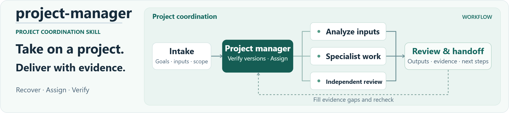
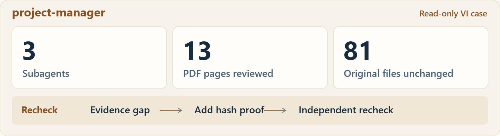

<p align="center"><a href="assets/overview/project-flow.en.svg"><picture><source media="(max-width: 600px)" srcset="assets/overview/project-flow.mobile.en.png"></picture></a></p>

<p align="center"><strong>Help your AI organize work like a small project team.</strong></p>
<p align="center">English · <a href="README.zh-CN.md">简体中文</a> · <a href="#skills">Choose a skill</a> · <a href="#case">Real-run case</a> · <a href="#install">Get and install (中文)</a></p>

xualab is a growing library of independently usable skills. Each skill has a clear job; combine capabilities only when a task needs them. The first skill is **project-manager**.

<a id="skills"></a>

## Choose a skill to start

<table><tr><td><h3><a href="skills/project-manager/README.md">project-manager</a></h3><p>Recover a complex project's goal and current sources, coordinate available specialist capabilities, and review the outputs before reporting.</p><p><a href="skills/project-manager/README.md#install">Install this skill →</a>　<a href="skills/project-manager/README.md#start">Choose a task mode →</a>　<a href="cases/vi-readonly-20261105/README.md">See a real run (中文) →</a></p></td></tr></table>

You do not need the whole library. Open the skill page, obtain its three runtime files, then place them in the actual project you want to work on.

<a id="install"></a>

## Copy an install prompt

**Codex / Claude Code**　Copy the whole block and paste it into a local client chat.

```text
Install project-manager from this GitHub repo:
https://github.com/xmonk888-art/xualab
Use the skills/project-manager directory.
Confirm the personal skill path for this client
and version. Preserve SKILL.md, agents/openai.yaml,
references/records-and-handoff.md, and LICENSE.
Keep any existing customizations.
Install only. Report the path, version,
and whether the client detects the skill.
```

**WorkBuddy**　[Download the standalone ZIP](https://github.com/xmonk888-art/xualab/releases/download/project-manager-v1.0.1/project-manager-1.0.1.zip), then import it with **Skills → Add skill → Upload skill**.

[Setup by client (中文)](docs/installation.md) · [Release notes](https://github.com/xmonk888-art/xualab/releases/tag/project-manager-v1.0.1)

## Library, skill, and project

| Location | Purpose |
| --- | --- |
| xualab library | Discover skills and read documentation and cases |
| `skills/<name>/` | Obtain one skill's instructions and runtime resources |
| Your working project | Keep source files, state, and deliverables; use selected skills |

The library expands when actual skills are added. The index does not advertise capabilities or teams that do not exist.

<a id="case"></a>

## In practice: what the review resolved

In a read-only VI review, the team reconciled an outdated task record with later completed work, identified font issues in a manual and reference artwork, and closed a report-evidence gap after a targeted independent recheck. The original design files were unchanged.

<p align="center"><a href="assets/overview/review-evidence.en.svg"><picture><source media="(max-width: 600px)" srcset="assets/overview/review-evidence.mobile.en.png"></picture></a></p>

Sanitized, maintainer-reported summary drawn from local Windows/Codex records dated 2026-11-05; not a software screenshot. No comparative baseline was collected; client inputs remain private.

[Roles and recheck (中文)](cases/vi-readonly-20261105/README.md) · [Verification scope (中文)](docs/validation.md)

## Where to go next

| Your next step | Entry |
| --- | --- |
| Install and confirm discovery | [Five-step setup (中文)](docs/installation.md) |
| Review first or execute authorized work | [Two task modes](skills/project-manager/README.md#start) |
| Continue, change computers, or resolve a gap | [Prompts (中文)](docs/usage.md) · [Portability (中文)](docs/portability.md) · [Troubleshooting (中文)](docs/troubleshooting.md) |

## Applicability and license

Skills need a host that can read project files and instructions. The verified scope is the local Windows/Codex read-only case above. Actual cross-computer use, other hosts, and production work remain untested. Software, credentials, and specialist tools come from the target environment.

Licensed under MIT. Copyright (c) 2026 xmonk888-art. [MIT and scope](LICENSE-STATUS.md) · [Contributing](CONTRIBUTING.md) · [Acknowledgements](ACKNOWLEDGEMENTS.md)
