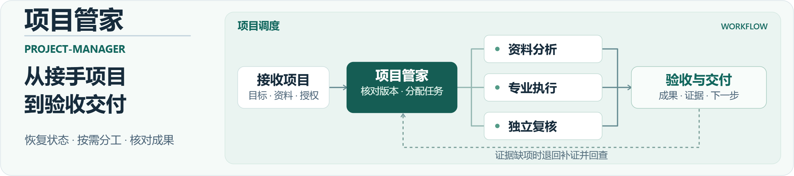

<a href="assets/overview/project-flow.zh-CN.svg"><picture><source media="(max-width: 600px)" srcset="assets/overview/project-flow.mobile.zh-CN.png"></picture></a>

<strong>让 AI 按小型项目团队的方式组织工作。</strong>

<a href="README.md">English</a> · 简体中文 · <a href="#skills">选择技能</a> · <a href="#case">实测展示</a> · <a href="docs/installation.md">获取与安装</a>

xualab 是可逐步扩充的技能总库：每个技能负责一种清楚的工作，可独立取得，按任务需要组合使用。当前首个技能是 **project-manager**，用于项目管家。

## 选择一个技能开始

<table><tr><td><h3><a href="skills/project-manager/README.zh-CN.md">project-manager · 项目管家</a></h3>
接续复杂项目时，恢复目标与版本，按需组织职责和已有专业技能，检查成果后汇报。

<a href="skills/project-manager/README.zh-CN.md#install">安装单个技能 →</a>　<a href="skills/project-manager/README.zh-CN.md#start">选择任务模式 →</a>　<a href="cases/vi-readonly-20261105/README.md">看一轮实测 →</a>
</td></tr></table>

不用先安装整个总库。进入技能页，按说明取得三个运行文件，再放到你真正要处理的业务项目中。

## 复制安装话术

Codex 与 Claude Code 提供一段话安装指令；WorkBuddy 自定义包通过“上传技能”导入。[单技能 ZIP](https://github.com/xmonk888-art/xualab/releases/download/project-manager-v1.0.1/project-manager-1.0.1.zip) · [版本说明](https://github.com/xmonk888-art/xualab/releases/tag/project-manager-v1.0.1)。

[打开三客户端安装说明](docs/installation.md)

## 总库、技能和项目，各放什么

| 位置 | 用途 |
| --- | --- |
| xualab 总库 | 发现技能、阅读说明与案例 |
| `skills/<技能名>/` | 取得某个技能的独立指令和运行资源 |
| 你的业务项目 | 保存源稿、当前状态和实际成果，使用选中的技能 |

总库中的专业能力按实际新增内容扩充；不预列尚不存在的技能或团队。

## 实测展示：先看解决了什么

在一次 VI 项目只读复核中，团队核对当前状态与实际文件，识别出旧待办与后续成功记录的冲突；发现规范样张和参考稿中的字体问题；并将一份报告的证据缺项补齐、独立回查关闭。设计原稿保持不变。

<a href="assets/overview/review-evidence.zh-CN.svg"><picture><source media="(max-width: 600px)" srcset="assets/overview/review-evidence.mobile.zh-CN.png"></picture></a>

图为维护者根据 2026-11-05 本机 Windows/Codex 记录绘制的脱敏摘要，不是软件截图；未采集对照基线，原始客户资料未公开。

[查看真实分工与回查过程](cases/vi-readonly-20261105/README.md) · [验证范围](docs/validation.md)

## 接下来去哪里

| 你想做什么 | 入口 |
| --- | --- |
| 安装并确认技能可用 | [五步上手](docs/installation.md) |
| 先检查项目，或执行已授权任务 | [单技能的两个开始入口](skills/project-manager/README.zh-CN.md#start) |
| 继续工作、换电脑或处理缺口 | [使用指令](docs/usage.md) · [迁移](docs/portability.md) · [排查](docs/troubleshooting.md) |

## 适用范围与许可

技能需要能读取项目文件与指令的 AI 宿主。已实测范围是上述本机 Windows/Codex 只读协作；实际跨电脑、其他宿主与生产制作尚未验证。软件、账号及专业工具由目标环境提供。

采用 MIT 许可证，版权署名为 xmonk888-art。[MIT 与许可范围](LICENSE-STATUS.md) · [贡献指南](CONTRIBUTING.md) · [来源与致谢](ACKNOWLEDGEMENTS.md)
