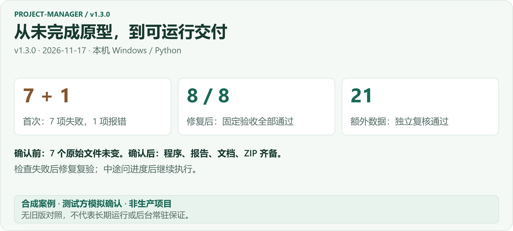

# 合成离线小项目实测 / Synthetic offline project trial

**2026-11-17 · project-manager 1.3.0 · 本机 Windows/Codex · Python 3.10.22 标准库。**

维护者根据本地实际工具执行与检查记录整理的脱敏摘要。输入为专门构造的 CSV 任务报告项目，不是真实客户生产业务；目标确认由测试方模拟。未公开完整源代码、原始聊天或完整日志，因此不是外部可直接重放的基准测试。

## 初始问题与最终目标

项目已有一个 CSV→JSON 原型，旧状态写“完成”但没有验收证据。新目标 v2 是让同事能解压离线运行，得到准确 JSON 和可读 HTML；拒绝错误输入并保护已有报告，附中文说明和限定内容的 ZIP。旧原型完成不覆盖这个最终目标。

## 方法

1. 一个不继承主对话历史的真实子助手读取新版技能及项目原始资料，先只读判断进度和提交目标确认单。
2. 测试方模拟使用者确认 v2 目标与四步计划后，执行助手才开始制作。期间插入一次进度询问。
3. 固定验收脚本先检查原型、记录失败，再用于检查修复后的结果。执行助手不修改原要求或验收标准，没有再派生子助手。
4. 执行助手交付代码、JSON、HTML、说明、ZIP和最终状态。主助手随后独立解压，增加输入数据复核并检查浏览器呈现。

这是经理串行统筹的执行验证，不是本版多员工并行测试。“离线”指产出的报告工具可离线运行，不表示模型会话或技能能断网常驻。

## 结果

<a href="../../assets/v1.3.0/trial-evidence.zh-CN.svg"><picture><source media="(max-width: 600px)" srcset="../../assets/v1.3.0/trial-evidence.mobile.zh-CN.png"></picture></a>

图为维护者绘制的结果摘要，不是软件截图。

| 项目 | 证据结果 |
| --- | --- |
| 确认前边界 | 7 个初始文件哈希完全不变，新增 0 |
| 最终目标确认 | v2 目标、交付物、通过条件、限制及计划记录齐全；确认由测试方模拟 |
| 首次固定验收 | 8 项中 7 失败、1 报错 |
| 修复后固定验收 | 8/8 通过；新源码哈希与首次不同 |
| 标准保持 | 项目说明、对话材料、需求、输入及验收脚本哈希不变 |
| 交付 | ZIP 解压运行通过；最终状态绑定目标与证据，无剩余必要项 |
| 额外独立复核 | 新增 21 条 BOM CSV；混合状态、重复编号、顺序、特殊字符及晚出现非法行保护通过 |
| 浏览器 | 样例/额外报告 × 1440/390 宽度，共 4 场景通过；无横向溢出、脚本错误、外部请求 |

执行助手交接时记录“未做浏览器视觉实测”；浏览器结果由主助手随后补充，二者时间与责任不混写。进度询问后的继续执行由实际代码、包、复验与交接佐证。

[结构化脱敏摘要](summary.json)含两轮源码哈希与测试工具交付 ZIP 哈希。该 ZIP 是 **CSV 报告小项目**，不是项目管家技能发行 ZIP；不能混用两者校验和。摘要用于绑定维护者保留记录，不能代替未公开原始文件的独立复现。

## 结论边界

本次支持“接手判断→确认目标→持续制作→修复复验→范围内交付”在当前环境可执行。不支持旧版对照、效率提升、总体成功率或所有项目永不停止的结论。未验证真实客户生产项目、多员工并行、长期运行、其他宿主、跨电脑及关闭会话后自行恢复。Skill 不包含后台常驻执行器。

历史 [VI 只读案例](../vi-readonly-20261105/README.md)仍为 task-orchestrator 1.0.0 的独立证据，不混入本次计数。

## English

**2026-11-17 · project-manager 1.3.0 · Local Windows/Codex · Python 3.10.22 standard library.** This is a sanitized maintainer-reported summary of actual execution on a synthetic CSV report project. The tester simulated user confirmation. It is not a real customer production case or a publicly replayable benchmark; the complete source, conversations, and raw logs are not included.

An existing CSV-to-JSON prototype was marked complete without acceptance evidence. Goal v2 required an offline runnable ZIP producing accurate JSON and readable HTML, rejecting invalid input while preserving previous reports, and including Chinese instructions. One real execution assistant read the skill and project inputs without inherited conversation history. It assessed the project read-only, proposed the goal and plan, then worked after tester approval. One progress question was inserted. It did not delegate further or change the requirements/test criteria.

All 7 initial files remained unchanged before approval; no files were added. The fixed 8-check suite first had 7 failures and 1 error; after repair all 8 passed, bound to a different source hash. Required source materials and the acceptance script were unchanged. The extracted project ZIP ran successfully. The coordinator subsequently reviewed 21 additional BOM CSV rows and both reports at 1440/390 widths: all 4 browser scenarios passed, without overflow, script errors, or external requests. Browser review happened after the execution assistant's handoff.

The [sanitized JSON](summary.json) retains counts, checks, and source/project-ZIP hashes. The project ZIP is the CSV tool, not the project-manager skill package. These hashes bind retained local evidence and do not provide the omitted files needed for public replay. “Offline” describes the resulting report tool, not model execution or a resident skill service.

This trial supports the stated workflow in this environment only. No old-skill-version or no-skill control was collected. It does not establish efficiency gains, overall success rates, or indefinite execution. Real customer production work, multiple workers in this version, other hosts/computers, long runs, and recovery after session closure remain untested. The historical VI case retains its task-orchestrator 1.0.0 attribution.

[完整验证范围 / Validation scope](../../docs/validation.md) · [技能说明 / Skill](../../skills/project-manager/README.md)
