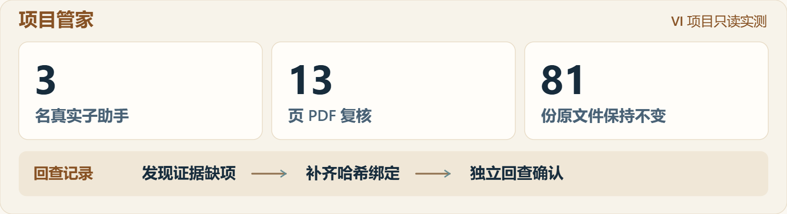

# 案例：VI 项目只读协作复核

**类型：真实运行的脱敏摘要。**日期：2026-11-05。环境：本机 Windows/Codex。技能：task-orchestrator 1.0.0。

本案例由维护者根据保留的本地实跑记录整理，内容经过缩写与概括。未公开客户名称、Logo、源稿、截图、磁盘路径或完整业务日志，也没有采集不用本技能的对照基线。因此它是范围明确的实践证据，不是公开可复现的基准测试或第三方认证。

> 更名说明：本次实测于 2026-11-05 使用旧名 `task-orchestrator` 1.0.0。2026-11-06 更名为 `project-manager · 项目管家`，仅调整名称、调用与界面说明；本页保留当时记录名称和实测范围，不把更名视为新的运行测试。

## 实测速览

<a href="../../assets/overview/review-evidence.zh-CN.svg"><picture><source media="(max-width: 600px)" srcset="../../assets/overview/review-evidence.mobile.zh-CN.png"></picture></a>

图为根据既有记录绘制的摘要，未使用客户素材或原软件截图。

## 任务

对已有 VI 项目检查当前状态、品牌规范、物料视觉和交付完整性，验证员工分工、专业技能调用及成果检查。原有文件保持只读；只允许在独立工作目录保存新增证据和报告。

## 实际分工

| 角色 | 实际工作 | 使用的能力 |
| --- | --- | --- |
| 主助手／项目负责人 | 恢复状态、分工、浏览器检查、整合与汇报 | task-orchestrator、宿主工具 |
| 品牌规范复核员 | 重新渲染 13 页规范，检查重点页、字体及原稿 | task-orchestrator、PDF 技能 |
| 物料视觉复核员 | 独立比较预览与参考，提取局部证据 | task-orchestrator、通用视觉分析 |
| 资产与交接复核员 | 核对版本、引用、依赖和文件；第二阶段抽查其他作者的报告 | task-orchestrator、PDF 技能及通用检查工具 |

共有 3 名真实子助手。视觉检查没有调用生图或重建技能；未把通用分析写成不存在的专业技能调用。交接复核员没有把自己第一阶段的报告冒充独立验收。

## 检查结果

| 项目 | 记录结果 |
| --- | --- |
| 真实子助手／首次交回报告 | 3／3 |
| 重新渲染的 PDF 页数 | 13 |
| 原有文件 | 81 份不变，0 份变化，0 份缺失 |
| 保留资产哈希匹配 | 70／70 |
| 核心资产哈希匹配 | 5／5 |
| HTML/CSS 依赖引用 | 46／46 |
| 浏览器场景 | 4；检查图像均解码，无横向溢出 |
| 报告补证 | 1 项缺少哈希绑定，补证及回查后关闭 |

这些计数的对象不同，不能将 70、5 和 81 相加当作总文件数，也不能将引用数当成独立文件数。

## 一次实际的退回与回查

交接复核发现主助手的一份浏览器检查报告没有把输入和截图绑定到具体哈希。主助手补充了记录，并重新执行受影响的四个场景；复核员随后定向核对，报告缺项关闭。修正对象是检查记录，没有修改设计原稿。

## 发现问题不等于修完问题

检查确认一处字体样张标称字重与实际渲染不符，参考矢量稿中的普通字体也与规范不一致；同时识别出旧待办与后续成功记录冲突，以及制作环境绑定本机路径等条件。

本轮保持只读，将设计问题和后续制作条件留给下一阶段。协调与交接在声明范围内通过，项目仍是审阅稿。

## 结论与未验证项

该案例支持当前环境中“实际派工 → 调用适用技能 → 交回证据 → 复核 → 补证回查”的只读协作链路。它没有验证跨电脑运行、原生 AI 文件编辑保存重开、生成账号、生产印刷、实体打样、长期后台运行或真实中断恢复。

[结构化摘要](summary.json) · [完整能力边界](../../docs/validation.md) · [返回技能](../../skills/project-manager/README.zh-CN.md)
