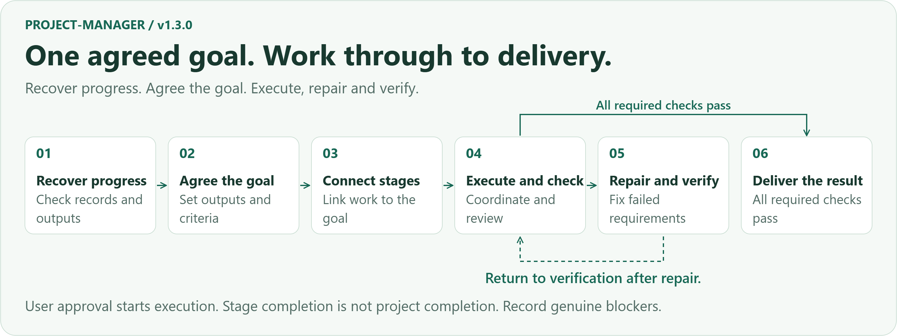
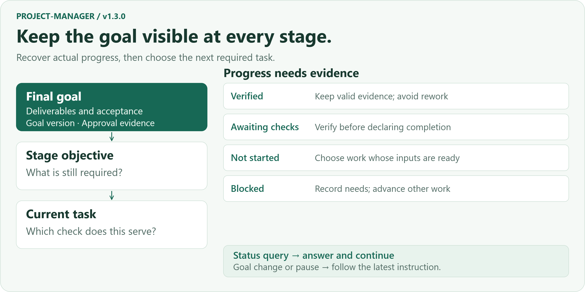
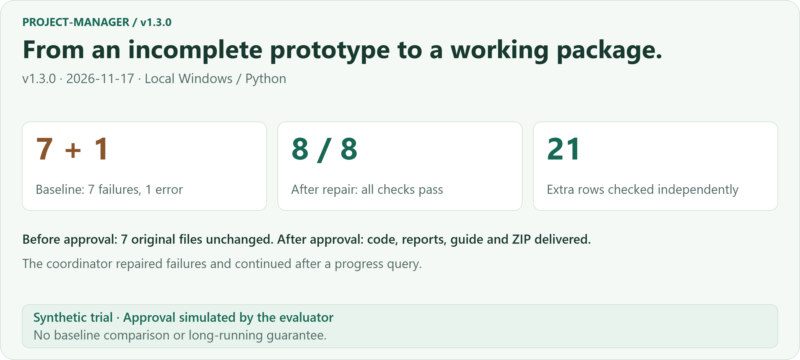

# project-manager

Assess actual progress, then coordinate work and verification around the confirmed final goal.

[简体中文](README.zh-CN.md) · [Get and install](#install) · [New behavior](#features) · [Start](#start) · [Trial](#case)

<p align="center"><a href="../../assets/v1.3.0/goal-flow.en.svg"><picture><source media="(max-width: 600px)" srcset="../../assets/v1.3.0/goal-flow.mobile.en.png"></picture></a></p>

<a id="latest-release"></a>

> **Latest version · v1.3.0**
>
> Verify actual progress, distinguish the final goal from stage goals and current tasks, and check every handoff against final acceptance. Retain repair, recheck, and genuine-blocker handling.
>
> [Download the update](https://github.com/xmonk888-art/project-manager/releases/download/project-manager-v1.3.0/project-manager-1.3.0.zip) · [Full release notes](https://github.com/xmonk888-art/project-manager/releases/tag/project-manager-v1.3.0)

<a id="install"></a>

## Get and install

Install the pinned **v1.3.0** skill from GitHub, or download the standalone ZIP above.

**Codex / Claude Code: copy into a local client chat.**

```text
Install only project-manager v1.3.0 from https://github.com/xmonk888-art/project-manager/tree/project-manager-v1.3.0/skills/project-manager. In Codex, use skill-installer; in other clients, verify the supported installation method first. Inspect and back up any existing installation and preserve customizations. Verify SKILL.md declares 1.3.0, retain runtime resources and MIT LICENSE, and keep the accurate Chinese interface description. Report the actual path, version, discovery result, and refresh requirements. Perform only a read-only invocation check; do not start a project or install other dependencies.
```

**WorkBuddy:** use the standalone ZIP and the existing **Skills → Add skill → Upload skill** guidance, then confirm activation. Other-client instructions are carried forward; **installation of this version in those clients has not been tested**.

[Client setup and checks](../../docs/installation.md) · [Troubleshooting (中文)](../../docs/troubleshooting.md)

<a id="features"></a>

## 1.3.0: connect every stage to the final delivery

Use this skill to take over an existing project, coordinate multiple stages, or avoid stopping after a partial result. Simple standalone tasks can use a specialist skill directly.

| Problem | Behavior | Visible result |
| --- | --- | --- |
| An old record says complete, but outputs are missing | Check goal version, files, and acceptance evidence | Evidence-backed completion, pending checks, unstarted work, and blockers; no guessed percentage |
| A task ends before the project goal is met | Map final goal, stage goals, and current tasks to required checks | Goal record, stage order, deliverables, and pass conditions |
| Every update needs another request to continue | Continue ready, required work within authorization; repair and recheck | Actual outputs, verification evidence, and remaining work |
| The goal or conditions change | Adjust methods within scope; follow explicit goal changes, pauses, or cancellation | Goal version, confirmation evidence, changes, and recovery conditions |

<p align="center"><a href="../../assets/v1.3.0/goal-board.en.svg"><picture><source media="(max-width: 600px)" srcset="../../assets/v1.3.0/goal-board.mobile.en.png"></picture></a></p>

This is a workflow illustration. A final goal may span several stages; if only one stage is authorized, deliver and report that stage. Reuse valid, unchanged approval. Submit a plan for confirmation before new work or material scope changes.

Repair and recheck, useful delegation, and one writer per shared artifact are existing capabilities. This version binds them more explicitly to the final goal. One assistant can carry responsibilities in sequence; real subagents depend on host support and authorization. The skill includes no specialist software, model accounts, or background runner.

<a id="start"></a>

## Start with a concrete task

Invocation is unchanged: Codex uses `$project-manager`; Claude Code uses `/project-manager`; in WorkBuddy, import and enable the skill, then ask to use project-manager. Mentioning the name does not prove it loaded.

<a id="check"></a>

### A · Assess progress read-only

```text
Use $project-manager to assess actual progress and authoritative source versions.
Distinguish final goal, stage goals, and current tasks. List completion evidence,
pending checks, unstarted work, and blockers. Recover valid approval and scope;
if missing, submit a goal record and plan for my confirmation.
Do not edit files, delegate, install, or publish this turn.
```

Expect an assessment, goal record, and plan. Read-only assessment should not produce edits or installations.

<a id="execute"></a>

### B · Continue approved work

```text
Use $project-manager to recover the confirmed final goal, goal version, and scope.
Check each stage against final deliverables and required acceptance conditions.
Continue tasks whose dependencies are met. Answer progress questions, then resume.
Repair and recheck failures against the original criteria; do not lower them.
Report delivery when required checks pass and outputs are complete. For genuine
blockers, retain evidence and recovery conditions. Follow explicit goal changes,
pause, or cancellation, and remain within existing authorization.
```

[More task and continuation prompts](../../docs/usage.md) · [Portability limits (中文)](../../docs/portability.md)

<a id="case"></a>

## New trial: from an old prototype to a runnable report package

**2026-11-17 · project-manager 1.3.0 · Local Windows/Codex · Synthetic offline project.** One real execution assistant took over a CSV prototype marked complete and identified missing HTML, input protection, documentation, and a ZIP under the new goal. After the tester simulated user approval of goal v2, the assistant built, repaired, rechecked, and handed over the project serially, without further delegation.

<p align="center"><a href="../../assets/v1.3.0/trial-evidence.en.svg"><picture><source media="(max-width: 600px)" srcset="../../assets/v1.3.0/trial-evidence.mobile.en.png"></picture></a></p>

| Check | Recorded result |
| --- | --- |
| Read-only before confirmation | All 7 initial file hashes unchanged; 0 new files |
| Fixed acceptance and repair | Initially 7 failures and 1 error; after repair 8/8 passed, bound to different source hashes |
| Final delivery | Actual execution from the extracted ZIP passed; required outputs present |
| Additional coordinator review | 21 new BOM CSV rows checked for duplicate IDs, order, special characters, and invalid-input protection |
| Browser review | Sample and additional reports at widths 1440 / 390; all 4 scenarios passed |

The graphic and numbers are a maintainer-reported summary of local records, not software screenshots. The tester simulated user confirmation. No old-version or no-skill control was collected; this does not quantify efficiency or guarantee long-running execution. The public summary omits the complete source and raw logs needed to replay the experiment.

[Method, results, and sanitized evidence](../../cases/goal-driven-trial-20261117/README.md) · [Validation scope](../../docs/validation.md)

## Historical evidence and untested scope

The [2026-11-05 read-only VI review](../../cases/vi-readonly-20261105/README.md) used **task-orchestrator 1.0.0**, before the rename: 3 subagents, 13 PDF pages, and 81 unchanged originals. It retains that version attribution and does not verify the new 1.3.0 behavior.

Real customer production projects, multi-worker execution in 1.3.0, long runs, other hosts, another computer, and automatic recovery after session closure remain untested. Desktop skill-list refresh and display after restart are also unverified. Future tasks need their own acceptance checks.

## Skill, project, and license

Obtain one skill's resources; keep business source files, state, and deliverables in the actual project. Runtime resources are `SKILL.md`, `agents/openai.yaml`, and `references/records-and-handoff.md`; retain `LICENSE` in distribution. Artwork and cases are reader documentation.

Current version **1.3.0**. MIT · Copyright (c) 2026 xmonk888-art.

[Library](../../README.md) · [Changelog](CHANGELOG.md) · [License scope](../../LICENSE-STATUS.md) · [Contributing](../../CONTRIBUTING.md) · [Acknowledgements](../../ACKNOWLEDGEMENTS.md)
