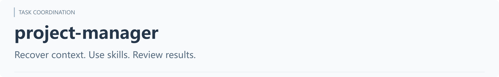
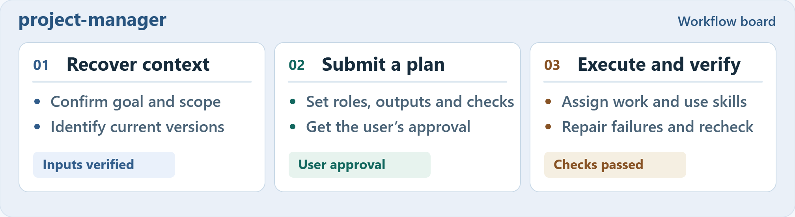
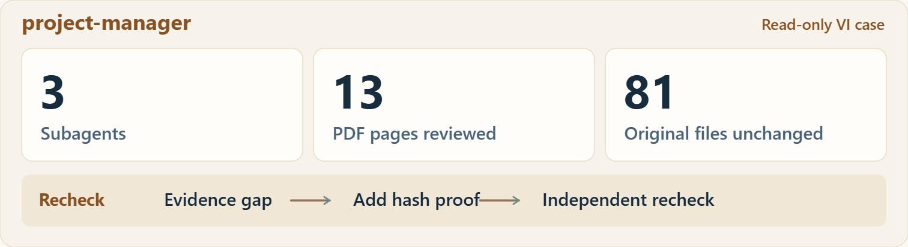

<p align="center"><picture><source media="(max-width: 600px)" srcset="../../assets/brand/project-manager.mobile.en.png"></picture></p>

<p align="center"><strong>Connect responsibilities, specialist skills, and review around one goal.</strong></p>
<p align="center"><a href="README.zh-CN.md">简体中文</a> · <a href="../../README.md">Skill library</a> · <a href="#install">Install</a> · <a href="#check">Read-only review</a> · <a href="#execute">Execute</a> · <a href="#case">Real run</a></p>

The main assistant recovers work from readable context and project files, coordinates available specialist skills, and checks results within the authorized scope. Keep simple tasks simple; organize a team when useful.

## How the work connects

<p align="center"><a href="../../assets/overview/work-board.en.svg"><picture><source media="(max-width: 600px)" srcset="../../assets/overview/work-board.mobile.en.png"></picture></a></p>

The coordinator owns the goal and integration. Shared artifacts and stateful sessions have one writer. Handoffs identify outputs and evidence; permitted fixes are followed by affected-scope checks.

<a id="install"></a>

## Copy an install prompt

**Codex / Claude Code**　Copy the whole block and paste it into a local client chat.

```text
Install project-manager from this GitHub repo:
https://github.com/xmonk888-art/xualab
Use the skills/project-manager directory.
Confirm the personal skill path for this client
and version. Preserve SKILL.md, agents/openai.yaml,
references/records-and-handoff.md, and LICENSE.
Keep any existing customizations.
Install only. Report the path, version,
and whether the client detects the skill.
```

**WorkBuddy**　[Download the standalone ZIP](https://github.com/xmonk888-art/xualab/releases/download/project-manager-v1.0.1/project-manager-1.0.1.zip), then import it with **Skills → Add skill → Upload skill**.

[Setup by client (中文)](../../docs/installation.md) · [Release notes](https://github.com/xmonk888-art/xualab/releases/tag/project-manager-v1.0.1)

## Start in five steps

| Step | Action |
| --- | --- |
| 1. Obtain | Get this skill from the local review package or repository; preserve relative paths and LICENSE |
| 2. Place | Copy runtime files and LICENSE to the chosen client's skill location, or upload the package in WorkBuddy |
| 3. Confirm | Confirm skill discovery or import and readable references in the selected client |
| 4. Choose | Select read-only review or execution of authorized work below |
| 5. Review | Look for actual outputs, verification evidence, and unresolved issues |

[Detailed setup (中文)](../../docs/installation.md) · [Troubleshooting (中文)](../../docs/troubleshooting.md)

<a id="start"></a>

Invocation: the templates below use Codex `$project-manager`. In Claude Code, start with `/project-manager`. In WorkBuddy, import and enable the skill first, then explicitly ask to use project-manager. Confirm actual discovery in your client; mentioning the name alone does not prove that it loaded.

## Choose how to start

**[A · Review first](#check)** to understand project state and gaps.  
**[B · Execute authorized work](#execute)** to progress within a defined scope.

<a id="check"></a>

### A · Read-only review

```text
Use $project-manager for a read-only startup review of this project.
Recover the goal, stage, and authoritative inputs. Propose roles, skills,
capability gaps, and acceptance criteria. Do not edit, delegate, or install. That is the scope of this run.
```

Expect an assessment and recommendations, not claims that workers have executed or originals changed.

<a id="execute"></a>

### B · Execute authorized work

Define the goal, deliverables, and permitted changes first. Reuse existing conversation when it already establishes them; supply them for a new project.

```text
Use $project-manager to continue this project's defined, authorized tasks.
Recover current state, assign useful responsibilities, use available skills,
and check the outputs. Handle routine decisions and permitted fixes.
Report actual deliverables, evidence, and unresolved issues. If a necessary
action exceeds authorization, finish independent work and explain the impact.
```

Expect actual deliverables, checks, and unresolved issues. Delegate only when the host supports and permits it; otherwise proceed serially. This is a usage template. Existing real-run evidence covers read-only collaboration, not production editing.

For continuation or another computer, see [handoff prompts (中文)](../../docs/usage.md).

<a id="case"></a>

## In practice: find issues and close an evidence gap

- Reconciled outdated tasks with later successful work instead of blindly repeating them.
- Identified font problems in the manual and reference artwork, leaving originals for a later authorized revision.
- Supplemented a missing report hash binding and closed it through a targeted independent recheck.

<p align="center"><a href="../../assets/overview/review-evidence.en.svg"><picture><source media="(max-width: 600px)" srcset="../../assets/overview/review-evidence.mobile.en.png"></picture></a></p>

Sanitized, maintainer-reported summary drawn from the 2026-11-05 local run, not a software screenshot. Client inputs remain private; no comparative baseline was collected.

[Roles and acceptance (中文)](../../cases/vi-readonly-20261105/README.md) · [Evidence scope (中文)](../../docs/validation.md)

## Current capability status

| Scope | Status |
| --- | --- |
| Local Windows/Codex read-only delegation, skill use, and report recheck | Real-run evidence available |
| Execute / revise mode | Instructions defined; verify each task's delivery; production editing untested |
| Another computer, other hosts, real interruption recovery, long runs | Untested |

Specialist skills, tools, fonts, software, and credentials come from the target environment. No background service or independent read-only sandbox is included. Real delegation follows host capabilities, authorization, and concurrency limits.

## Runtime and license

Current release: **1.0.1**. Only `SKILL.md`, `agents/openai.yaml`, and `references/records-and-handoff.md` are required; artwork and cases are reader documentation.

Licensed under MIT. Copyright (c) 2026 xmonk888-art. [MIT and scope](../../LICENSE-STATUS.md) · [Changelog](CHANGELOG.md) · [Portability (中文)](../../docs/portability.md)
