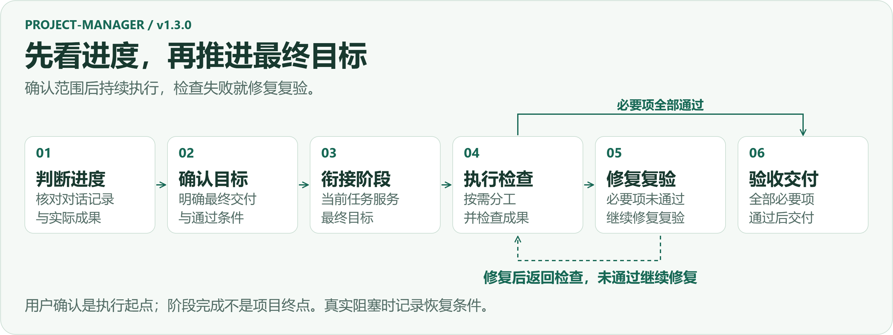
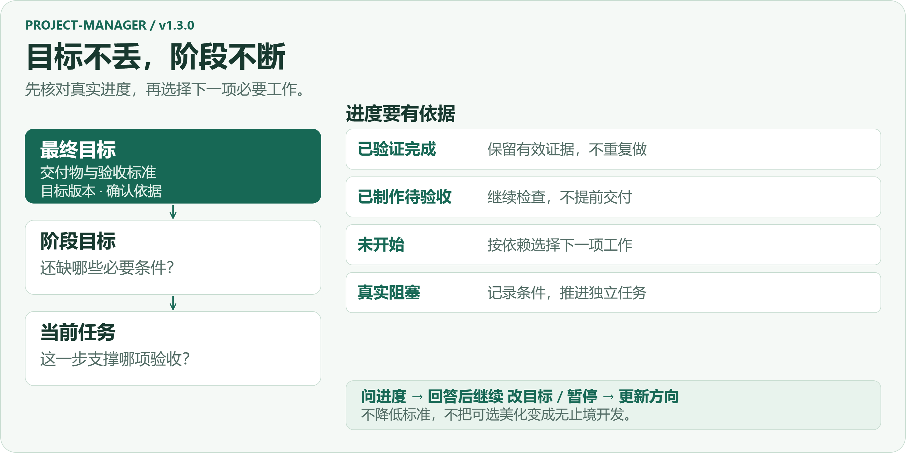
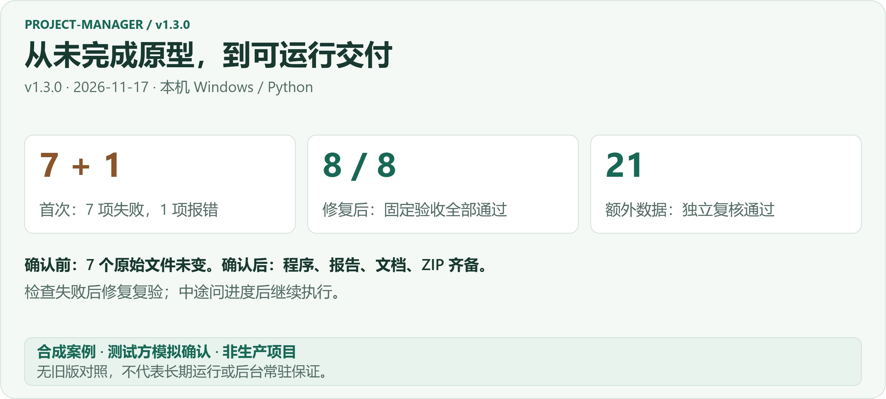

# 项目管家 · project-manager

让 AI 先判断实际进度，再围绕已确认的最终目标组织工作、检查和交付。

[English](README.md) · [获取与安装](#install) · [新功能](#features) · [开始使用](#start) · [本次实测](#case)

<p align="center"><a href="../../assets/v1.3.0/goal-flow.zh-CN.svg"><picture><source media="(max-width: 600px)" srcset="../../assets/v1.3.0/goal-flow.mobile.zh-CN.png"></picture></a></p>

<a id="latest-release"></a>

> **最新版 · v1.3.0**
>
> 接手时核实实际进度，区分最终目标、阶段目标与当前任务；每次交接对照最终验收继续推进。保留失败修复、复验和真实阻塞记录。
>
> [下载新版 ZIP](https://github.com/xmonk888-art/project-manager/releases/download/project-manager-v1.3.0/project-manager-1.3.0.zip) · [完整更新说明](https://github.com/xmonk888-art/project-manager/releases/tag/project-manager-v1.3.0)

<a id="install"></a>

## 获取与安装

可直接从 GitHub 安装指定的 **v1.3.0**，或下载上方单技能 ZIP。

**Codex / Claude Code：复制到本地客户端对话。**

```text
请从 https://github.com/xmonk888-art/project-manager/tree/project-manager-v1.3.0/skills/project-manager 安装项目管家 project-manager v1.3.0。Codex 请使用 skill-installer；其他客户端先核对实际支持的安装方式。只安装此技能，先检查并备份已有同名技能，保留自定义内容。核对 SKILL.md 版本为 1.3.0，保留运行资源和 MIT LICENSE，保持 agents/openai.yaml 的准确中文说明。安装后报告实际路径、版本、技能识别结果和刷新要求；只做只读调用检查，不启动实际项目，不安装其他依赖。
```

**WorkBuddy：**下载该单技能 ZIP，按已有说明通过“技能 → 添加技能 → 上传技能”导入并确认启用。其他客户端说明沿用既有资料，**未进行本版安装实测**。

[分客户端安装与检查](../../docs/installation.md) · [安装排查](../../docs/troubleshooting.md)

<a id="features"></a>

## 1.3.0：每个阶段都对应最终交付

适合接手已有项目、推进多阶段任务，或避免只完成局部工作就结束。单项简单任务直接使用对应专业技能。

| 你遇到的问题 | 项目管家如何处理 | 你能看到什么 |
| --- | --- | --- |
| 旧记录写“完成”，实际交付仍不齐 | 核对目标版本、文件和验收依据 | 已完成、待验收、未开始与阻塞；缺口标为待核实，不猜百分比 |
| 当前任务做完，最终目标仍未达到 | 分清最终目标、阶段目标和当前任务，各阶段对应必要验收项 | 目标确认单、阶段顺序、交付物与通过条件 |
| 每次汇报后都要重新催促 | 继续已授权且依赖已满足的必要工作，失败后修复复验 | 实际产物、检查证据和剩余项 |
| 目标或条件变化 | 方法可在授权内调整；明确改目标、暂停或取消按新指令处理 | 目标版本、确认依据、变更与恢复条件 |

<p align="center"><a href="../../assets/v1.3.0/goal-board.zh-CN.svg"><picture><source media="(max-width: 600px)" srcset="../../assets/v1.3.0/goal-board.mobile.zh-CN.png"></picture></a></p>

图为工作规则示意。最终目标可覆盖多个阶段，本次只授权一个阶段时，只交付并报告该阶段。已有确认且目标未变时直接沿用；新项目或实质变更先提交计划供用户确认。

修复复验、按需分工、单一写入负责人是已有能力；本版把这些工作进一步绑定到最终目标。职责可由同一助手顺序承担，真实子助手取决于宿主能力与授权。Skill 不自带专业软件、模型账号或后台常驻执行器。

<a id="start"></a>

## 从一个明确任务开始

调用方式不变：Codex 使用 `$project-manager`；Claude Code 使用 `/project-manager`；WorkBuddy 先导入并启用，再提出“使用项目管家（project-manager）”。名称出现在消息里不等于技能已加载。

<a id="check"></a>

### A · 先只读判断进度

```text
使用 $project-manager，只读核对当前项目实际进度与权威版本。
区分最终目标、阶段目标和当前任务，列出完成证据、待验收、未开始及阻塞。
恢复已有确认和授权；缺少确认时提交目标确认单和计划，等我确认。
本轮不修改文件、不实际派工、不安装或发布。
```

应收到进度判断、目标与计划；只读阶段不应出现制作或安装结果。

<a id="execute"></a>

### B · 继续已经批准的工作

```text
使用 $project-manager，恢复已确认的最终目标、目标版本及授权范围。
逐阶段对照最终交付与必要验收，继续依赖已满足的任务。
进度询问先回复再继续；检查失败按原标准修复并复验，不自行降标。
必要项通过且交付齐全后汇报；真实阻塞时保存证据和恢复条件。
明确改目标、暂停或取消时遵从我的新指令，不超出已有授权。
```

[更多任务与续作指令](../../docs/usage.md) · [跨电脑交接边界](../../docs/portability.md)

<a id="case"></a>

## 新实测：从旧原型到可解压运行的报告工具

**2026-11-17 · project-manager 1.3.0 · 本机 Windows/Codex · 合成离线项目。**一个真实执行助手接手带旧“完成”状态的 CSV 原型，识别新目标还缺 HTML、输入保护、说明和 ZIP。测试方模拟使用者确认 v2 目标后，助手串行制作、修复、复验并交接，未再派生员工。

<p align="center"><a href="../../assets/v1.3.0/trial-evidence.zh-CN.svg"><picture><source media="(max-width: 600px)" srcset="../../assets/v1.3.0/trial-evidence.mobile.zh-CN.png"></picture></a></p>

| 检查 | 记录结果 |
| --- | --- |
| 确认前只读 | 7 个初始文件哈希不变，新增文件 0 |
| 固定验收与修复 | 首次 7 失败、1 报错；修复后 8/8 通过，记录绑定不同源码哈希 |
| 最终交付 | ZIP 解压后的实际运行通过；必要交付齐全 |
| 主助手额外复核 | 新增 21 条 BOM CSV，检查重复编号、顺序、特殊字符及错误输入保护 |
| 浏览器复核 | 样例与额外报告各检查 1440 / 390 宽度，共 4 场景通过 |

图和数字是维护者依据本地记录整理的摘要，不是软件截图。目标确认由测试方模拟；无旧版或不用技能的对照，不量化效率提升，不保证长期持续执行。公开摘要不包含可重放全套实验的源代码与原始日志。

[完整方法、结果及脱敏证据](../../cases/goal-driven-trial-20261117/README.md) · [验证范围](../../docs/validation.md)

## 历史案例与未验证范围

[2026-11-05 VI 只读复核](../../cases/vi-readonly-20261105/README.md)使用更名前的 **task-orchestrator 1.0.0**：3 名子助手、13 页 PDF、81 份原文件不变。保留原归属，不用于证明 1.3.0 新功能。

尚未验证真实客户生产项目、1.3.0 多员工并行、长期运行、其他宿主、跨电脑及会话关闭后的自动恢复。桌面技能列表刷新和重启后的显示也未实测。未来任务仍按自身验收条件检查。

## 技能、项目与许可

取得单个技能即可；业务源稿、状态和交付物保留在实际项目中。运行资源为 `SKILL.md`、`agents/openai.yaml`、`references/records-and-handoff.md`，分发保留 `LICENSE`。图和案例是阅读资料。

当前版本 **1.3.0**。MIT · Copyright (c) 2026 xmonk888-art。

[总库入口](../../README.zh-CN.md) · [版本记录](CHANGELOG.md) · [许可范围](../../LICENSE-STATUS.md) · [贡献](../../CONTRIBUTING.md) · [致谢](../../ACKNOWLEDGEMENTS.md)
