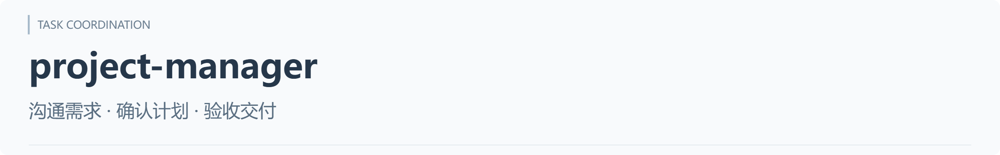
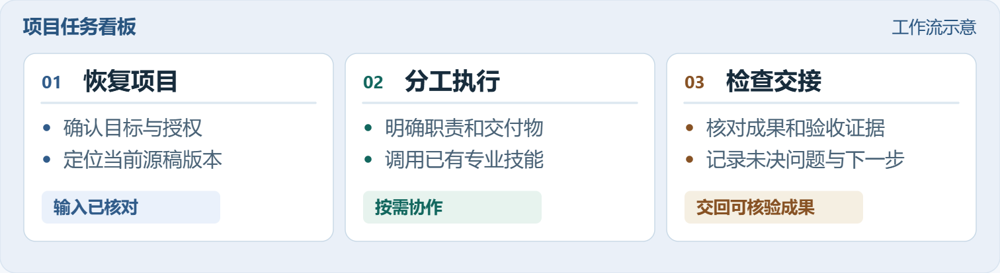
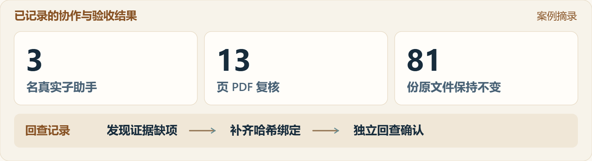

<p align="center"><picture><source media="(max-width: 600px)" srcset="../../assets/brand/project-manager.mobile.zh-CN.png"></picture></p>

<p align="center"><strong>让分工、专业技能和成果检查，围绕同一个目标衔接。</strong></p>
<p align="center"><a href="README.md">English</a> · <a href="../../README.zh-CN.md">技能总库</a> · <a href="#install">安装</a> · <a href="#check">只读检查</a> · <a href="#execute">执行任务</a> · <a href="#case">实测</a></p>

主助手根据当前可读取的对话和项目资料恢复工作，在授权范围内按需安排职责、调用已有专业技能、整合并检查成果。简单任务直接处理，复杂任务再组织团队。

## 一轮工作如何衔接

<p align="center"><a href="../../assets/overview/work-board.zh-CN.svg"><picture><source media="(max-width: 600px)" srcset="../../assets/overview/work-board.mobile.zh-CN.png"></picture></a></p>

主助手负责整体目标与整合。共享文件或有状态软件会话设一个写入负责人，交接附成果位置和证据；修复后回查受影响部分。

<a id="install"></a>

## 安装：先选客户端

[Codex 一段话安装](../../docs/installation.md) · [Claude Code 一段话安装](../../docs/installation.md) · [WorkBuddy 上传包](../../docs/installation.md)

[下载单技能 ZIP](https://github.com/xmonk888-art/xualab/releases/download/project-manager-v1.0.0/project-manager-1.0.0.zip) · [版本说明](https://github.com/xmonk888-art/xualab/releases/tag/project-manager-v1.0.0)。其他客户端仅核对了官方加载方式，尚未实装。

## 五步开始使用

| 步骤 | 你要做什么 |
| --- | --- |
| 1. 获取 | 从本地审阅包或仓库目录取得本技能，保留运行文件、LICENSE 及完整相对结构 |
| 2. 放置 | Codex/Claude Code 按各自目录复制；WorkBuddy 上传技能包；一并保留 LICENSE |
| 3. 确认 | 在所选客户端确认技能已发现或导入、引用文件可读取 |
| 4. 选任务 | 选择下方“只读检查”或“执行已授权任务” |
| 5. 看结果 | 检查实际交付、验收证据和未解决项，而不只看一份计划 |

[完整安装说明](../../docs/installation.md) · [识别或运行异常排查](../../docs/troubleshooting.md)

调用方式：以下模板以 Codex 的 `$project-manager` 为例。Claude Code 请将开头换成 `/project-manager`；WorkBuddy 请先导入并启用技能，再用“使用项目管家（project-manager）”明确选择。安装方式和实际识别需按各客户端核对，不能把名称写进消息视为已成功加载。

<a id="start"></a>

## 选择本轮怎么开始

**[A · 先检查项目](#check)**：了解状态、分工与能力缺口。  
**[B · 执行已授权任务](#execute)**：在已明确的范围内推进到成果和验收。

<a id="check"></a>

### A · 只读检查

```text
使用 $project-manager，先只读恢复当前项目的目标、阶段和权威版本。
提出分工建议、可用技能、能力缺口与验收方案。
本轮不修改源文件、不实际派工、不创建或安装技能。
```

预期收到项目启动判断和建议，不应报告员工已经执行或原稿已被修改。

<a id="execute"></a>

### B · 执行已授权任务

先明确目标、交付物和允许修改范围。已有对话说清楚时可以直接使用；新项目请补充这些信息。

```text
使用 $project-manager，继续当前项目中已明确且已授权的任务。
先恢复状态，再按需分工、调用已有技能，完成成果检查后向我汇报。
常规判断和授权范围内的修复自行推进；说明实际交付、检查结果和未解决项。
遇到超出授权的必要动作，先完成可独立推进的部分，再说明具体影响。
```

预期收到实际成果、检查结果和未解决项；宿主支持且允许时按需委派，否则串行推进。该指令是使用模板，现有实测覆盖只读协作，尚未验证生产制作修订。

继续旧任务或换电脑时，使用[续作与交接指令](../../docs/usage.md)。

<a id="case"></a>

## 实测：发现问题，并把证据补齐

- 核对旧待办与后续成功记录，恢复真实进展，避免盲目重做。
- 发现规范样张字重及参考稿字体问题，记录影响，保留原件待后续授权修订。
- 独立复核发现报告缺少哈希绑定，补证并定向回查后关闭。

<p align="center"><a href="../../assets/overview/review-evidence.zh-CN.svg"><picture><source media="(max-width: 600px)" srcset="../../assets/overview/review-evidence.mobile.zh-CN.png"></picture></a></p>

图为维护者根据 2026-11-05 本机记录绘制的脱敏摘要，不是软件截图；原始客户资料不公开，未采集对照基线。

[完整分工与验收过程](../../cases/vi-readonly-20261105/README.md) · [验证依据](../../docs/validation.md)

## 当前能力状态

| 范围 | 状态 |
| --- | --- |
| 本机 Windows/Codex，只读分工、技能调用、报告补证回查 | 已有真实实测 |
| 执行／修订模式 | 指令与规则已定义；实际交付须按任务验收，生产制作未实测 |
| 另一台电脑、其他宿主、真实中断恢复、长期运行 | 尚未实测 |

专业技能、工具、字体、软件和账号由目标环境提供；本技能不建立后台服务或独立只读沙箱。实际委派受宿主能力、权限和并发限制约束。

## 运行文件与许可

版本仍为 **1.0.0**。运行只需 `SKILL.md`、`agents/openai.yaml`、`references/records-and-handoff.md`，图和案例供人阅读。

采用 MIT 许可证，版权署名为 xmonk888-art。[MIT 与许可范围](../../LICENSE-STATUS.md) · [版本记录](CHANGELOG.md) · [迁移说明](../../docs/portability.md)
